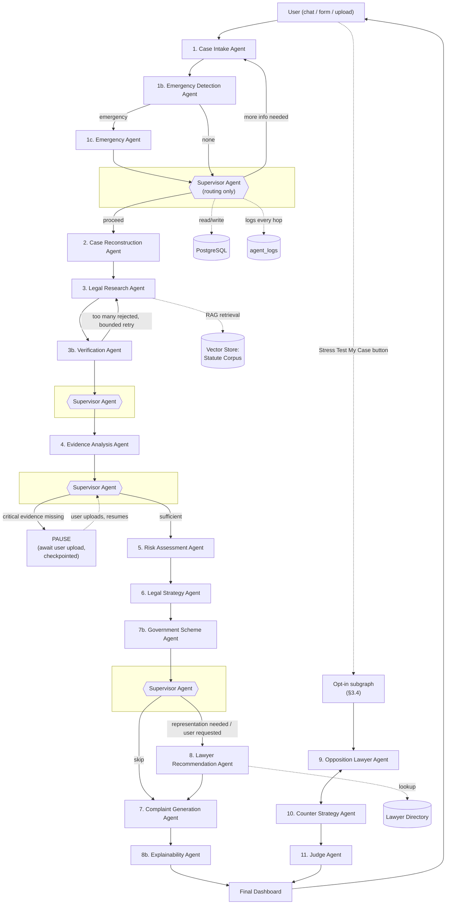

# 2. Agent Architecture

> **Revision note (v2)**: the pipeline is no longer strictly linear. A **Supervisor Agent** now makes routing decisions between stages, and 4 new agents (Emergency Detection, Verification, Explainability, Government Scheme) have been added. This doc reflects the current (v2) agent roster — 16 agents total. The graph mechanics are in [03-langgraph-workflow.md](03-langgraph-workflow.md).

## 2.1 Design contract every agent obeys

Every agent is a thin, testable unit implementing the same interface — no agent hand-rolls its own prompting/parsing/retry logic.

```python
class AgentPort(Protocol):
    name: str
    input_schema: type[BaseModel]
    output_schema: type[BaseModel]

    async def run(self, state: CaseState) -> AgentResult[OutputT]: ...
```

`BaseAgent` (in `agents/base.py`) provides the shared machinery so individual agents only implement a system prompt + an `_build_input()` / `_parse_output()` pair:

- Renders a **modular system prompt** from `prompts/<agent_name>.py` (never inline strings).
- Calls Gemma through LangChain's `.with_structured_output(output_schema)` — the LLM is *forced* into the agent's Pydantic contract; on validation failure it retries with the validation error fed back into context (max 2 retries, then raises `AgentExecutionError`).
- Wraps execution with the **observability decorator**: logs latency, token usage, retry count, and failure to `agent_logs`, and emits an OpenTelemetry span.
- Is **stateless** between calls — all context comes from `CaseState`, nothing is held in instance attributes across invocations, so agents are safe under concurrent case processing.

## 2.2 The 16 agents

### 2.2.1 Meta / control agents

| # | Agent | Input (from state) | Output contract | Side effects |
|---|---|---|---|---|
| 0 | **Supervisor Agent** | condensed `CaseState` summary (flags/scores/status only — never raw facts) | `RoutingDecision{next_node, reason, needs_user_input}` | None persisted beyond `agent_logs`; **never** writes case data |

The Supervisor is deliberately fed a *summary* of state, not the full case narrative — it routes on flags (`missing_fields empty?`, `is_emergency?`, `completeness_score`, `case_strength`, `strategy requires representation?`) rather than re-reasoning about the legal facts. This is what keeps it fast, cheap, and honest to its "routing only, no legal reasoning" mandate (Change 1). See [03-langgraph-workflow.md](03-langgraph-workflow.md) §3.3 for exactly where it's invoked.

### 2.2.2 Pipeline agents

| # | Agent | Input (from state) | Output contract | Side effects |
|---|---|---|---|---|
| 1 | **Case Intake Agent** | raw user message(s), existing `CaseProfile` (partial), `language` | `CaseProfile` (+ `missing_fields: list[str]`) | Persists partial `Case` row; may loop (routed by Supervisor) |
| 1b | **Emergency Detection Agent** | latest `CaseProfile` delta (runs after every intake turn) | `EmergencyAssessment{is_emergency, category, severity, ...}` | Writes `emergency_assessments`; **short-circuits** routing (Change 4) |
| 1c | **Emergency Agent** | `EmergencyAssessment` | `EmergencyGuidance{immediate_steps, evidence_checklist, helplines, recommended_authorities}` | Displayed immediately to user; does not block eventual return to normal flow |
| 2 | **Case Reconstruction Agent** | `CaseProfile` | `Timeline` (`list[TimelineEvent]`, `inconsistencies: list[str]`) | Writes `case_timeline_events` |
| 3 | **Legal Research Agent** | `Timeline` + `CaseProfile` | `LegalResearchResult` (`list[LegalProvision]` with citations) | RAG retrieval against statute vector store; writes `legal_research_results` |
| 3b | **Verification Agent** | `LegalResearchResult` | `VerifiedLegalResearchResult{verified_provisions, rejected_citations}` | Writes verification flags onto `legal_citations`; **only verified citations ever reach the user** (Change 2) |
| 4 | **Evidence Analysis Agent** | `CaseProfile.evidence`, `Timeline` | `EvidenceReport` (`completeness_score`, gaps, suggestions) | Writes `evidence` rows + `evidence_reports` |
| 5 | **Risk Assessment Agent** | all of the above | `RiskAssessment` (financial/criminal/urgency/case-strength scores) | Writes `risk_scores` |
| 6 | **Legal Strategy Agent** | `RiskAssessment` + `VerifiedLegalResearchResult` | `StrategyPlan` (`list[StrategyOption]` w/ cost/time/difficulty/success probability, `requires_representation: bool`) | Writes `strategies` |
| 7 | **Complaint Generation Agent** | chosen/top `StrategyOption` + `CaseProfile` + `Timeline` | `list[GeneratedDocument]` (formatted legal drafts) | Writes `documents` |
| 7b | **Government Scheme Agent** | `CaseProfile`, `RiskAssessment` | `GovernmentSchemeReport{matches: list[GovernmentSchemeMatch]}` | Writes `government_scheme_matches`; always attempted (cheap, high user value — Change 5) |
| 8 | **Lawyer Recommendation Agent** | `CaseProfile.location`, `StrategyPlan.required_specialization` | `list[LawyerMatch]` | Writes `case_lawyer_matches`; **conditionally executed** (Change 8 — see §3.3) |
| 8b | **Explainability Agent** | full `CaseState` (all structured outputs so far) | `ExplainabilityReport{items: list[ExplainabilityItem]}` | Writes `explainability_reports`; runs immediately before dashboard finalization (Change 3) |

### 2.2.3 Opt-in adversarial agents (see §3.4 — "Stress Test My Case")

| # | Agent | Input (from state) | Output contract | Side effects |
|---|---|---|---|---|
| 9 | **Opposition Lawyer Agent** | full case state | `OppositionReport` (`list[Objection]` by category) | Writes `opposition_rounds` (role=`opposition`) |
| 10 | **Counter Strategy Agent** | latest `OppositionReport` | `CounterReport` (`list[Rebuttal]`, `additional_evidence_needed`) | Writes `opposition_rounds` (role=`counter`) |
| 11 | **Judge Agent** | full opposition↔counter history | `JudgeOpinion` (strengths, weaknesses, likely outcome, settlement recommendation) | Writes `judge_opinions`; updates dashboard |

Each agent has its **own** system prompt file under `prompts/` (e.g. `prompts/opposition_lawyer.py`), versioned independently. Prompts are never string-concatenated across agents — shared boilerplate (tone, JSON-only instruction, injection-resistance preamble, target-language instruction per [12-multilingual-architecture.md](12-multilingual-architecture.md)) lives in `prompts/_shared.py` and is composed, not duplicated. See [10-design-decisions.md](10-design-decisions.md) §Prompt Engineering for the injection-defense pattern.

## 2.2.4 The Supervisor is not "agent #12" in the pipeline sense

Every other agent produces domain output that gets persisted and shown to the user. The Supervisor produces **only** a `RoutingDecision` — it is infrastructure, not a pipeline stage, which is why it's numbered `0` above and why its box in the diagram below sits *outside* the linear flow rather than inside it.

## 2.3 Agent interaction diagram (v2 — supervisor-routed)



Notes:
- `SUP`, `SUP2`, `SUP3`, `SUP4` are the **same** Supervisor Agent invoked at 4 distinct decision points — drawn as separate nodes only for diagram readability. See [03-langgraph-workflow.md](03-langgraph-workflow.md) §3.3 for the single `supervisor_route()` implementation shared by all four.
- `A9 <--> A10` is a bounded loop (max `N` rounds, default 3) — unchanged from v1, but now reachable **only** through the opt-in "Stress Test My Case" subgraph (Change 6), never automatically.
- The `PAUSE` node is a real LangGraph checkpoint boundary, not a visual simplification — the graph genuinely returns control to the API/user and resumes later from Postgres-persisted state (Change 7).
- Every agent box also fans out to `agent_logs` (omitted per-arrow for readability) — logging is enforced by the `BaseAgent` wrapper, not opt-in per agent.

## 2.4 Why agents don't call each other directly

Agents never import or invoke one another — including the Supervisor. The Supervisor does not call `LegalResearchAgent.run()`; it returns a `RoutingDecision` naming the next **node**, and the graph itself performs the transition. This is deliberate:
- Keeps each agent unit-testable with a hand-built `CaseState` fixture and no network/DB.
- Makes the LangGraph graph the single source of truth for control flow — reading `graph_builder.py` tells you the entire pipeline (now including all supervisor-conditioned branches); you never have to trace call chains through agent files.
- Lets us swap orchestration frameworks later without rewriting agents (agents only depend on `CaseState` + `AgentPort`, not on LangGraph internals).
- Keeps the Supervisor honest to its "routing only" mandate — it structurally *cannot* perform legal reasoning or write case data, because its only output type (`RoutingDecision`) has no field for it.

## 2.5 Emergency Detection is cheap and runs every turn

Unlike the other new agents, Emergency Detection Agent runs on **every** intake turn (not once per case) because an emergency disclosure can surface at any point in a multi-turn interview, not just at the end. To keep this affordable, it is intentionally narrow-scope: a small, fast structured-output call classifying only `is_emergency` + `category` + `severity` against the fixed category list in [08-pydantic-schemas.md](08-pydantic-schemas.md) §8.13 — it does not re-read the full case history, only the latest user message plus the categories it's screening for.

Continue to [03-langgraph-workflow.md](03-langgraph-workflow.md).
