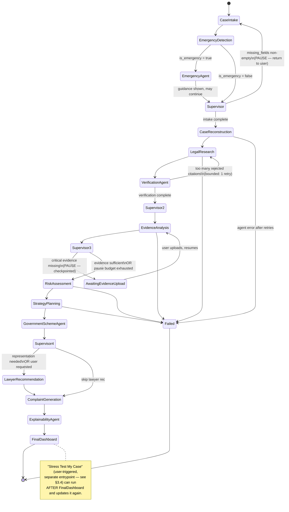
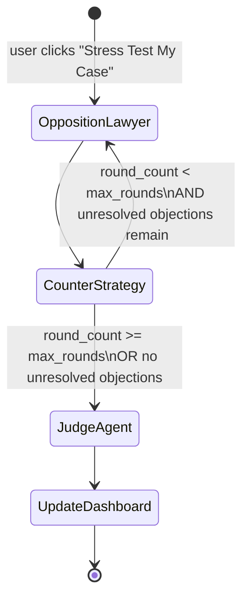

# 3. LangGraph Workflow (v2 — Supervisor-Routed)

> **Revision note**: v1 of this document described a fixed linear pipeline with two hand-coded loops (intake, opposition↔counter). v2 replaces most fixed edges with **Supervisor-conditioned** edges, adds an emergency short-circuit, a checkpointed evidence-pause loop, and moves the opposition↔counter↔judge branch behind an explicit opt-in trigger. The two structural primitives from v1 (graph-not-chain, Postgres checkpointing) are unchanged and still the foundation everything else is built on.

## 3.1 Why a graph, not a chain (unchanged, now with more reasons)

Four parts of this pipeline are non-linear, up from two in v1:
1. **Intake** is a multi-turn interview — pause, return control to the user, resume.
2. **Emergency detection** must be able to interrupt the pipeline from *any* point during intake, not just at the end.
3. **Evidence collection** may need to pause mid-pipeline and wait for a user upload (Change 7), not just during intake.
4. **Opposition ↔ Counter Strategy** is an adversarial loop, now reachable only via explicit user action rather than automatically.

None of this is expressible as a sequential chain. LangGraph's conditional edges + cycles + Postgres checkpointing remain the right primitive, and the Supervisor Agent (Change 1) is what actually *decides* the conditional edges at runtime instead of the graph author hard-coding fixed transitions.

## 3.2 State schema (v2)

```python
class CaseState(TypedDict):
    case_id: UUID
    user_id: UUID
    status: CaseStatus
    language: SupportedLanguage              # NEW — user's preferred interaction language

    # accumulated structured outputs (each optional until its agent runs)
    case_profile: CaseProfile | None
    emergency_assessment: EmergencyAssessment | None      # NEW
    emergency_guidance: EmergencyGuidance | None           # NEW
    timeline: Timeline | None
    legal_research: LegalResearchResult | None
    verified_legal_research: VerifiedLegalResearchResult | None   # NEW
    evidence_report: EvidenceReport | None
    risk_assessment: RiskAssessment | None
    strategy_plan: StrategyPlan | None
    documents: list[GeneratedDocument]
    government_scheme_report: GovernmentSchemeReport | None       # NEW
    lawyer_matches: list[LawyerMatch]
    explainability_report: ExplainabilityReport | None            # NEW

    # adversarial loop (now opt-in, see §3.4)
    stress_test_requested: bool               # NEW — set by POST /case/stress-test
    opposition_rounds: list[OppositionRound]
    round_count: int
    max_rounds: int

    judge_opinion: JudgeOpinion | None

    # adaptive evidence collection (NEW, Change 7)
    awaiting_evidence_upload: bool
    evidence_pause_count: int                  # bounds repeated pause/ask/resume cycles

    # supervisor routing (NEW, Change 1)
    last_routing_decision: RoutingDecision | None

    # control
    missing_fields: list[str]
    errors: list[str]
    messages: list[BaseMessage]
```

`CaseStatus` enum (v2, additions marked): `INTAKE_IN_PROGRESS`, `INTAKE_COMPLETE`, **`EMERGENCY_DETECTED`**, **`EMERGENCY_HANDLING`**, `RECONSTRUCTING`, `RESEARCHING`, **`VERIFYING_CITATIONS`**, `ANALYZING_EVIDENCE`, **`AWAITING_EVIDENCE_UPLOAD`**, `ASSESSING_RISK`, `PLANNING_STRATEGY`, **`CHECKING_GOV_SCHEMES`**, `GENERATING_DOCUMENTS`, `MATCHING_LAWYERS`, **`EXPLAINING`**, `COMPLETE`, `SIMULATING_OPPOSITION`, `JUDGED`, `FAILED`.

## 3.3 Graph definition



## 3.4 The opt-in adversarial subgraph ("Stress Test My Case")

Per Change 6, Opposition Lawyer / Counter Strategy / Judge **never** run as part of the main pipeline above. They are a separate, smaller graph invoked only by `POST /case/stress-test`:



This subgraph loads the **existing** checkpointed `CaseState` for `case_id` (it does not re-run intake through complaint generation), appends its own `opposition_rounds`/`judge_opinion`, and re-invokes only the dashboard aggregation step. It has its own compiled `CompiledGraph` (`stress_test_graph`) — kept separate from `main_graph` rather than folded in as one more conditional branch, because it has a fundamentally different trigger (explicit user action, not automatic routing) and the two graphs' failure/retry semantics shouldn't be entangled.

## 3.5 The Supervisor Agent's routing contract

The Supervisor is invoked as the `condition` function of `add_conditional_edges` at four points (§3.3: `Supervisor`, `Supervisor2`, `Supervisor3`, `Supervisor4`) — it is the **same** node/agent, called with a different state slice each time. Each call site maps the Supervisor's `RoutingDecision.next_node` onto a small legal set of destinations for that point in the graph (the Supervisor cannot route arbitrarily — its output is validated against the legal-edges-from-here set, and an illegal choice is treated as a validation failure subject to the standard `BaseAgent` retry, same as any other schema violation):

```python
async def supervisor_route(state: CaseState, legal_targets: set[NodeName]) -> NodeName:
    decision = await supervisor_agent.run(state)   # -> RoutingDecision
    if decision.next_node not in legal_targets:
        raise AgentExecutionError(f"Supervisor chose illegal target {decision.next_node}")
    return decision.next_node

graph.add_conditional_edges(
    "case_intake_and_emergency_check",
    partial(supervisor_route, legal_targets={"case_intake", "case_reconstruction"}),
)
graph.add_conditional_edges(
    "evidence_analysis",
    partial(supervisor_route, legal_targets={"awaiting_evidence_upload", "risk_assessment"}),
)
graph.add_conditional_edges(
    "government_scheme_agent",
    partial(supervisor_route, legal_targets={"lawyer_recommendation", "complaint_generation"}),
)
```

The Supervisor's own system prompt (`prompts/supervisor.py`) is given only: current `status`, `missing_fields`, `emergency_assessment.is_emergency`, `evidence_report.completeness_score`, `risk_assessment` scores if present, and `strategy_plan.requires_representation` if present — never the free-text case narrative. This is the enforcement mechanism behind "the Supervisor should never perform legal reasoning itself": it structurally does not receive the inputs legal reasoning would require.

## 3.6 Adaptive evidence collection (Change 7)

`evidence_analysis` → `Supervisor3` is a real pause point, not a retry loop. When `EvidenceReport.gaps` contains a `priority=CRITICAL` item, the Supervisor routes to `awaiting_evidence_upload`, which:
1. Sets `state.status = AWAITING_EVIDENCE_UPLOAD`, `state.awaiting_evidence_upload = True`.
2. Checkpoints and returns control — `POST /case/evidence` responds with the specific gap description and a prompt to the user.
3. When the user later calls `POST /case/evidence` with new items, the graph **resumes from checkpoint** at `evidence_analysis` (not from the start), re-scores completeness, and the Supervisor re-decides.

`evidence_pause_count` bounds this: after 2 pause/resume cycles without reaching an acceptable completeness score, the Supervisor is instructed (via a hard rule in its prompt, not a soft suggestion) to proceed to `risk_assessment` regardless — the case proceeds with a documented evidence gap rather than looping indefinitely. The Explainability Agent later surfaces this gap explicitly under "missing information" for whatever conclusions it affected (§2.2.2).

## 3.7 Emergency short-circuit (Change 4)

`emergency_detection` runs after **every** `case_intake` turn, not just once. When `is_emergency = True`:
1. `state.status = EMERGENCY_DETECTED`, then `EMERGENCY_HANDLING`.
2. The graph routes to `emergency_agent` immediately — bypassing the Supervisor entirely for this one hop, because "was an emergency detected" is a hard boolean, not a judgment call the routing agent needs to weigh.
3. `EmergencyAgent` produces `EmergencyGuidance` (steps, evidence checklist, helplines, authorities), which the API surfaces to the user **before** anything else in the response.
4. Control then passes to the Supervisor as normal — the emergency guidance does not stop the rest of the pipeline from continuing (a domestic violence case still needs its legal research, evidence analysis, etc.), it just guarantees the safety-critical guidance is never delayed behind the rest of the pipeline.

## 3.8 Checkpointing & resumability (unchanged principle, more pause points)

`PostgresCheckpointer` persists `CaseState` after every node using `thread_id = case_id`. v2 has three resumable pause points instead of one: intake (`missing_fields`), evidence collection (`awaiting_evidence_upload`), and — architecturally distinct, not a pause but a separate graph — the stress-test subgraph, which "resumes" in the sense of loading the main graph's final checkpoint as its starting state. No server holds any of this in memory; any API replica or worker can drive any case forward from its last checkpoint.

## 3.9 Error handling in the graph (unchanged)

Each node's agent call is wrapped by `BaseAgent` retry logic. Persistent failure after retries raises `AgentExecutionError`, caught by a graph-level error boundary that logs to `agent_logs`, sets `state.status = FAILED`, and routes to a terminal `Failed` node. `POST /case/{id}/retry` resumes from the last successful checkpoint.

## 3.10 Round cap rationale (unchanged, now scoped to the opt-in subgraph)

`max_rounds` defaults to 3, configurable via `core/config.py` or per-request on `POST /case/stress-test`. Since this subgraph is now opt-in rather than automatic (Change 6), the cost/latency argument from v1 still applies, but it's now purely about bounding a single explicit user action rather than bounding every case's default pipeline cost — a meaningful cost reduction for the common case where a user never clicks "Stress Test My Case."

Continue to [04-database-design.md](04-database-design.md).
