# 4. Database Design

> **Revision note (v2)**: adds `emergency_assessments`, `government_scheme_matches`, `explainability_reports`; extends `legal_citations` with verification columns; extends `cases` with `preferred_language` and adaptive-evidence/stress-test control columns. New tables/columns are marked **NEW** below.

## 4.1 ER Diagram

```mermaid
erDiagram
    USERS ||--o{ CASES : owns
    USERS ||--o{ LONG_TERM_MEMORY : has
    CASES ||--o{ CASE_TIMELINE_EVENTS : contains
    CASES ||--o{ EVIDENCE : contains
    CASES ||--o{ DOCUMENTS : generates
    CASES ||--o{ LEGAL_RESEARCH_RESULTS : has
    CASES ||--o{ RISK_SCORES : has
    CASES ||--o{ STRATEGIES : has
    CASES ||--o{ COMPLAINTS : has
    CASES ||--o{ AGENT_LOGS : logs
    CASES ||--o{ CONVERSATION_MEMORY : has
    CASES ||--o{ OPPOSITION_ROUNDS : has
    CASES ||--o| JUDGE_OPINIONS : concludes_with
    CASES ||--o{ CASE_LAWYER_MATCHES : matches
    LAWYERS ||--o{ CASE_LAWYER_MATCHES : matched_in
    LEGAL_RESEARCH_RESULTS ||--o{ LEGAL_CITATIONS : cites
    CASES ||--o{ EMERGENCY_ASSESSMENTS : may_have
    CASES ||--o{ GOVERNMENT_SCHEME_MATCHES : matches
    CASES ||--o{ EXPLAINABILITY_REPORTS : has

    USERS {
        uuid id PK
        string email UK
        string hashed_password
        string full_name
        string phone
        string preferred_language "NEW"
        timestamptz created_at
        timestamptz updated_at
    }

    CASES {
        uuid id PK
        uuid user_id FK
        string status
        string title
        string incident_category
        jsonb case_profile
        string preferred_language "NEW"
        bool stress_test_requested "NEW"
        bool awaiting_evidence_upload "NEW"
        int evidence_pause_count "NEW"
        int max_rounds
        int round_count
        timestamptz created_at
        timestamptz updated_at
    }

    CASE_TIMELINE_EVENTS {
        uuid id PK
        uuid case_id FK
        timestamptz occurred_at
        string description
        bool is_inconsistent
        string inconsistency_note
        int sequence_order
    }

    EVIDENCE {
        uuid id PK
        uuid case_id FK
        string evidence_type
        string description
        string file_url
        string quality_rating
        timestamptz created_at
    }

    LEGAL_RESEARCH_RESULTS {
        uuid id PK
        uuid case_id FK
        string jurisdiction
        jsonb applicable_laws
        string plain_explanation
        timestamptz created_at
    }

    LEGAL_CITATIONS {
        uuid id PK
        uuid legal_research_result_id FK
        string act_name
        string section
        string source_url
        text excerpt
        bool is_verified "NEW"
        string verification_status "NEW - verified/unverified/rejected"
        text verification_notes "NEW"
        timestamptz verified_at "NEW"
    }

    EMERGENCY_ASSESSMENTS {
        uuid id PK
        uuid case_id FK
        bool is_emergency
        string category
        string severity
        jsonb immediate_steps
        jsonb evidence_preservation_checklist
        jsonb helplines
        jsonb recommended_authorities
        timestamptz created_at
    }

    GOVERNMENT_SCHEME_MATCHES {
        uuid id PK
        uuid case_id FK
        string scheme_name
        bool eligible
        float confidence
        jsonb documents_required
        text how_to_apply
        string relevant_authority
        timestamptz created_at
    }

    EXPLAINABILITY_REPORTS {
        uuid id PK
        uuid case_id FK
        text conclusion
        text reasoning
        jsonb supporting_evidence_refs
        jsonb supporting_legal_refs
        float confidence_score
        jsonb missing_information
        timestamptz created_at
    }

    RISK_SCORES {
        uuid id PK
        uuid case_id FK
        float financial_risk
        float criminal_risk
        string urgency_level
        bool needs_police
        bool needs_lawyer
        bool needs_medical
        float settlement_probability
        float case_strength
        timestamptz created_at
    }

    STRATEGIES {
        uuid id PK
        uuid case_id FK
        string forum
        float estimated_cost
        string estimated_time
        string difficulty
        float success_probability
        bool is_recommended
        timestamptz created_at
    }

    DOCUMENTS {
        uuid id PK
        uuid case_id FK
        string document_type
        text content
        string format
        string status
        timestamptz created_at
    }

    COMPLAINTS {
        uuid id PK
        uuid case_id FK
        uuid document_id FK
        string filed_with
        string status
        timestamptz filed_at
    }

    LAWYERS {
        uuid id PK
        string full_name
        string specialization
        string city
        jsonb languages
        float fee_range_min
        float fee_range_max
        float rating
        int years_experience
        string contact_info
    }

    CASE_LAWYER_MATCHES {
        uuid id PK
        uuid case_id FK
        uuid lawyer_id FK
        float match_score
        string match_reason
        timestamptz created_at
    }

    OPPOSITION_ROUNDS {
        uuid id PK
        uuid case_id FK
        int round_number
        string role
        jsonb content
        timestamptz created_at
    }

    JUDGE_OPINIONS {
        uuid id PK
        uuid case_id FK
        jsonb strengths
        jsonb weaknesses
        string likely_outcome
        text settlement_recommendation
        jsonb recommended_improvements
        timestamptz created_at
    }

    AGENT_LOGS {
        uuid id PK
        uuid case_id FK
        string agent_name
        string status
        int latency_ms
        int tokens_input
        int tokens_output
        int retry_count
        text error_message
        timestamptz created_at
    }

    CONVERSATION_MEMORY {
        uuid id PK
        uuid case_id FK
        string role
        text content
        string language "NEW - original language of this turn"
        timestamptz created_at
    }

    LONG_TERM_MEMORY {
        uuid id PK
        uuid user_id FK
        string memory_type
        jsonb content
        vector embedding
        timestamptz created_at
    }
```

## 4.2 Design notes

- **`cases.case_profile` is `jsonb`, not fully normalized.** The evolving intake payload (facts collected so far, arbitrary structure per incident type) is stored as the canonical `CaseProfile` Pydantic model serialized to JSONB. Fields that need to be queried/filtered at scale (`status`, `incident_category`, `user_id`) are pulled out as real columns; everything else stays JSONB to avoid a 15-column table that changes shape every time an agent's schema evolves. This is a deliberate denormalization — see [10-design-decisions.md](10-design-decisions.md).
- **`opposition_rounds` is a single append-only table**, not two tables for opposition/counter. `role` discriminates (`'opposition'` | `'counter'`), `round_number` orders them. This makes reconstructing the full adversarial transcript a single `ORDER BY round_number, role` query and matches how the LangGraph loop actually appends to `state.opposition_rounds`.
- **`risk_scores` and `strategies` are versioned by `created_at`, not overwritten.** If a case is re-run (e.g., after new evidence is added), history is preserved for audit — the dashboard reads the latest row per `case_id`, but nothing is destructively updated. This matters for a legal product: a user or lawyer may need to see "what did the system say before vs. after."
- **`long_term_memory.embedding` uses `pgvector`** (`vector` column type) so cross-case semantic recall ("has this user had a similar dispute before?") is a single SQL query via `<->` distance, without a second retrieval system just for memory. The statute corpus RAG (Chroma/FAISS) is a separate concern — see [11-scalability-roadmap.md](11-scalability-roadmap.md) for why they start on different stores.
- **`agent_logs` is intentionally wide and append-only** (one row per agent invocation, including retries) — this is the raw material for the observability requirements (latency, token usage, failures, retries) and must never be updated in place. The Supervisor Agent's routing calls are logged here too (`agent_name = 'supervisor'`), which gives us a free audit trail of every routing decision the system made for a case — useful both for debugging "why didn't Lawyer Recommendation run" and for eventually reviewing whether the Supervisor is routing well.
- **`legal_citations` gets verification columns rather than a separate `citation_verifications` table** (NEW, Change 2). A citation's verification status is 1:1 with the citation row, updated once by the Verification Agent right after Legal Research produces it — there's no independent lifecycle that would justify a separate table, and keeping it inline means `SELECT * FROM legal_citations WHERE case_id = ? AND is_verified` is the entire "what can we show the user" query.
- **`emergency_assessments` is append-only, one row per intake turn where the check ran** (NEW, Change 4), not just one row per case — since emergency detection re-runs on every intake turn (§3.7 of the workflow doc), history of the assessment across turns is preserved for audit (e.g., "the system correctly flagged this on turn 3, why didn't the UI show it").
- **`government_scheme_matches` and `explainability_reports` are versioned by `created_at` like `risk_scores`/`strategies`** (§4.2 above) — both agents can re-run if upstream data changes, and history should not be destroyed.

## 4.3 Indexing

- `cases(user_id, status)` — dashboard "my active cases" queries.
- `cases(preferred_language)` — analytics on language usage (NEW).
- `case_timeline_events(case_id, sequence_order)` — ordered timeline fetch.
- `agent_logs(case_id, created_at)` — per-case execution trace.
- `opposition_rounds(case_id, round_number)` — transcript reconstruction.
- `lawyers(city, specialization)` — recommendation filtering; add `rating DESC` for tie-breaking.
- `legal_citations(legal_research_result_id, is_verified)` — dashboard "verified only" filter (NEW).
- `emergency_assessments(case_id, created_at)` — latest assessment lookup (NEW).
- `long_term_memory` — `ivfflat`/`hnsw` index on `embedding` once corpus size justifies it (see scalability doc).

## 4.4 Migrations

Alembic manages all schema change; every table above ships as its own initial revision grouped by bounded context (`0001_users`, `0002_cases`, `0003_case_support_tables`, …) so context-specific rollbacks are possible without reverting unrelated tables.

Continue to [05-api-specification.md](05-api-specification.md).
