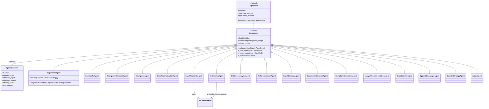
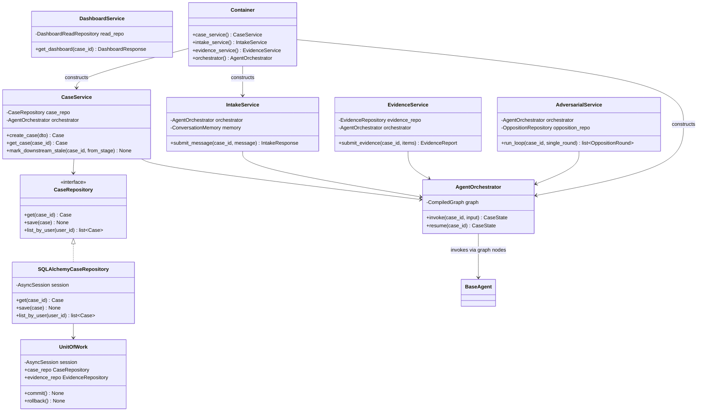

# 7. Class Diagram

> **Revision note (v2)**: adds `SupervisorAgent` (constrained to `RoutingDecision` output only, §8.11) and 4 new pipeline agents to the hierarchy; adds their services.

## 7.1 Agent hierarchy

## 7.2 Service / Repository / DI layers

## 7.3 Notes

- `AgentOrchestrator` is the **only** class that knows about LangGraph's `CompiledGraph` — services depend on `AgentOrchestrator`'s narrow interface (`invoke`/`resume`), not on LangGraph types, so the orchestration engine could be replaced without touching any service.
- `UnitOfWork` is injected into repositories, not the reverse — a single request/graph-node opens one UoW, all repository writes within it share the same `AsyncSession`, and `Container` scopes UoW lifetime to the request/task boundary.
- `Container` (in `core/container.py`) is the single composition root — the only place concrete implementations (`SQLAlchemyCaseRepository`, `GemmaChatModel`, `ChromaVectorStore`) are wired to interfaces. Every other file references interfaces/protocols only.

Continue to [08-pydantic-schemas.md](08-pydantic-schemas.md).
