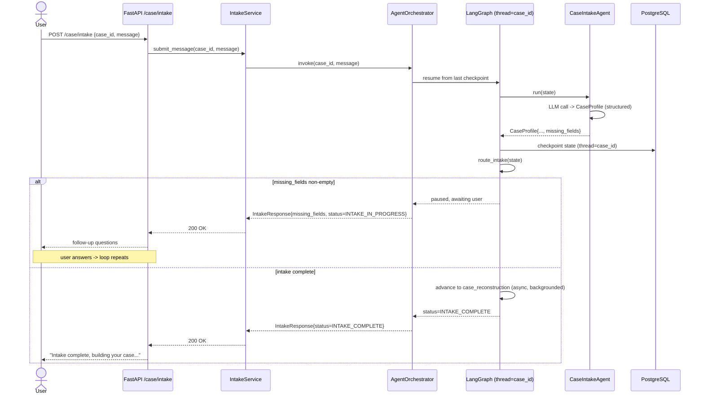
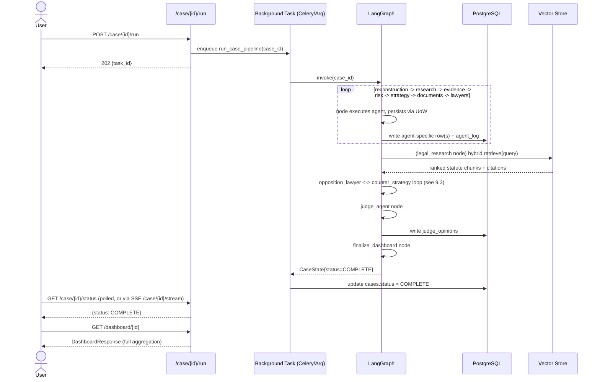
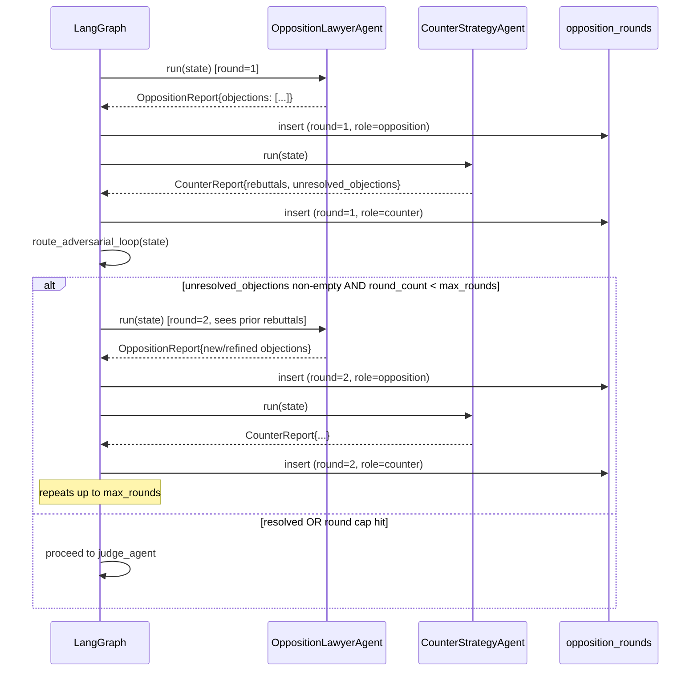
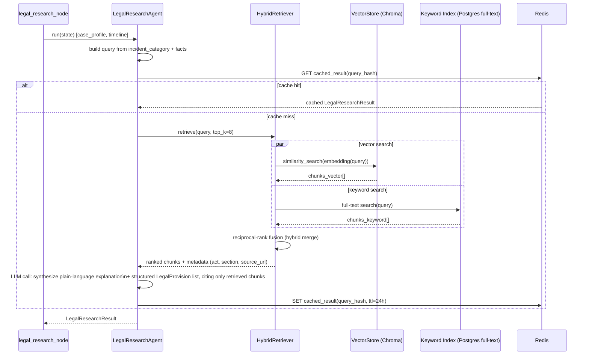
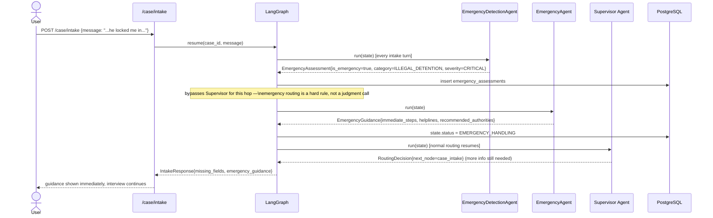
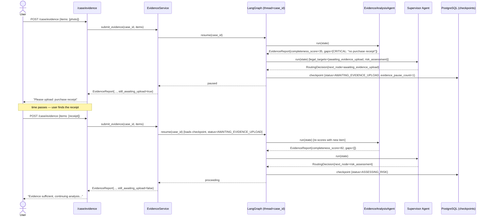

# 9. Sequence Diagrams

> **Revision note (v2)**: §9.1–9.4 remain structurally accurate — intake is still a resumable multi-turn loop, the pipeline still flows in this general shape, the opposition↔counter loop still bounds by `max_rounds`, RAG retrieval is unchanged. Read them with two updates in mind: (1) every stage transition in §9.2 is now a Supervisor-conditioned edge rather than a fixed `add_edge`, per [03-langgraph-workflow.md](03-langgraph-workflow.md) §3.5; (2) §9.3's opposition↔counter loop now starts only from `POST /case/stress-test`, never automatically (Change 6). Two genuinely new flows — emergency short-circuit and adaptive evidence pause/resume — are added below as §9.5 and §9.6.

## 9.1 Interactive intake loop

The only part of the pipeline that is multi-turn by nature — modeled as repeated calls into the same LangGraph thread, resumed from checkpoint each time.

## 9.2 Full pipeline happy path (post-intake, single pass)

## 9.3 Opposition ↔ Counter Strategy adversarial loop

## 9.4 RAG legal research retrieval

## 9.5 Emergency short-circuit (NEW, Change 4)

## 9.6 Adaptive evidence collection — pause and resume (NEW, Change 7)

Continue to [10-design-decisions.md](10-design-decisions.md).
