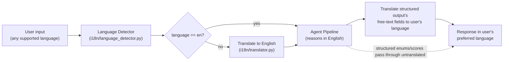

# 12. Multilingual Architecture (Change 9)

This is a Gemma Hackathon submission — multilingual support is a first-class requirement, not a bolt-on. NyayaOS supports **English, Hindi, Bengali, Tamil, Telugu, Marathi, Gujarati, Punjabi, Kannada, Malayalam, Urdu** from day one, with the architecture designed to add more languages without touching agent logic.

## 12.1 Core principle: agents always reason in English

Every agent (`agents/*.py`) receives and produces **English** structured data. Structured fields (enums, scores, booleans, dates) are language-independent by construction (§8.16) — only free-text fields (`summary`, `reasoning`, `argument`, document `content`, chat messages) carry language. This means:
- Legal reasoning quality doesn't degrade with translation round-trips through low-resource languages — Gemma reasons in the language it's strongest at.
- The statute corpus (RAG, [11-scalability-roadmap.md](11-scalability-roadmap.md)) stays a single English-indexed collection — no need to maintain parallel corpora per language.
- Agent unit tests stay language-agnostic (fixtures are always English `CaseState`).

Translation is therefore an **edge concern**, handled entirely by the `i18n/` package (§6, folder structure) at two boundaries: user input → English (before intake), and English output → user's language (before the response leaves the API).

## 12.2 Pipeline

## 12.3 Language detection & selection precedence

1. Explicit `language` field on the request (`POST /case/intake`, `POST /case` `preferred_language`).
2. `i18n/language_detector.py` auto-detects from the raw message text if `language` is omitted (Gemma-based or a lightweight fastText/langid detector — see §12.6 for the tradeoff).
3. Falls back to `case.preferred_language` (set at case creation) → `user.preferred_language` → `DEFAULT_LANGUAGE` from config (§13).

Once established for a case, `CaseState.language` is sticky for that case — it doesn't re-detect every turn unless the user explicitly switches (a detected language mismatch on a later turn is treated as a signal to *ask*, not silently switch, since a wrong auto-switch mid-case would be jarring).

## 12.4 Where translation happens in the graph

Translation is **not** a graph node — it happens in the thin adapter layer immediately outside `graph/nodes/`, consistent with the folder-structure rule (§6.1) that `i18n/` is never imported by `agents/`:

- `IntakeService.submit_message()` translates the incoming user message to English *before* constructing the LangGraph input, and translates `CaseProfile.summary` / `missing_fields` prompts back to `state.language` *after* the node returns, before building `IntakeResponse`.
- `DashboardService.get_dashboard()` translates every free-text field in the aggregated `DashboardResponse` to the requested `?lang=` (or case default) at read time — meaning a single case can be viewed in different languages by different viewers (e.g., the user in Hindi, a lawyer they've shared it with in English) without re-running any agent.
- `DocumentService` generates `GeneratedDocument.content` in the language needed for filing — legal documents (police complaints, legal notices) are typically filed in English or the state's official language regardless of the user's conversational language, so `POST /case/complaint` accepts its own `document_language` override, separate from `CaseState.language`.

## 12.5 Prompt design for multilingual output

Per Change 9's instruction ("prompt every agent to respond in the user's preferred language while keeping structured JSON language-independent"), the actual mechanism is:
- `prompts/_shared.py`'s composed preamble includes a `{target_language}` slot.
- Only agents whose output includes user-facing free text (Case Intake follow-up questions, Legal Research `plain_explanation`, Emergency Agent guidance, Explainability reasoning) receive a non-English `target_language`.
- Every agent's Pydantic schema field names, enum values, and numeric scores are generated in English regardless of `target_language` — this is enforced by explicit instruction in `_shared.py` ("output valid JSON matching the schema; only prose string VALUES may be in {target_language}, all keys and enum values remain in English") plus the structured-output constraint itself (ADR-3) — an enum field literally cannot validate a Hindi string against a `StrEnum` of English values, so this is schema-enforced, not just prompt-enforced.

This means `i18n/prompt_localizer.py` (§6, folder structure) has a narrow job: inject `{target_language}` into the ~6 agents that produce user-facing prose, not all 16.

## 12.6 Model choice for translation

Preferred: **Gemma 3n**, which has native multilingual capability, used both for the primary agent reasoning *and* as the translation layer — avoids standing up a second translation-specific model/service. If Gemma 3n is unavailable in a given deployment, fall back to **Gemma 3 with multilingual prompting** (explicit translate-this-text prompts) — same `TranslatorPort` interface (`i18n/translator.py`), different backing model, selected via `LLM_PROVIDER`/`GEMMA_MODEL_NAME` config (§13). This is an ADR-4-style port/adapter split: `IntakeService` and `DashboardService` depend on `TranslatorPort`, never on which Gemma variant backs it.

## 12.7 Adding a language

Because `SupportedLanguage` (§8.16) is a closed `StrEnum` and every consumer switches on it, adding a language is a 3-step, single-PR change:
1. Add the ISO code to `SupportedLanguage` in `schemas/language.py`.
2. Add it to `SUPPORTED_LANGUAGES` in config (§13) — this is the runtime-visible list the API validates incoming `language` fields against, decoupled from the enum so a language can be "known but disabled" during rollout.
3. Verify `i18n/translator.py`'s backing model actually supports it (Gemma 3n's language coverage is the practical ceiling — a language added to the enum without model support degrades to English fallback with a logged warning, not a hard failure).

No agent, node, prompt, or schema file changes — this is the payoff of keeping translation entirely at the edge (§12.1, §12.4).

## 12.8 What is explicitly out of scope for v1

- **Voice input/output** is a separate future adapter (see [11-scalability-roadmap.md](11-scalability-roadmap.md) §11.6) that would sit in front of this same pipeline (STT → this pipeline's text-in path → TTS), not a v1 requirement here.
- **Per-field mixed-language output** (e.g., English legal citations inline within a Hindi sentence) is a UI rendering concern, not a backend one — the backend returns fully localized prose; if the frontend wants to keep citations in Latin script/English for precision, that's a presentation-layer choice downstream of this API.

Continue to [13-configuration-and-devops.md](13-configuration-and-devops.md).
